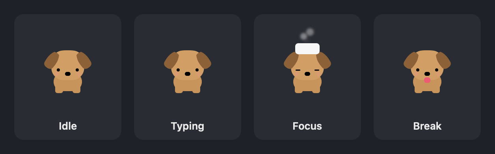

<p align="center">
  
</p>

<h1 align="center">Waggle 🐶</h1>

<p align="center">
  A tiny desktop companion for focus, breaks, and the moments in between.
  <br />
  Native macOS · SwiftUI + AppKit · Local-first
</p>

<p align="center">
  <a href="#meet-waggle">Meet Waggle</a> ·
  <a href="#run-it-locally">Run it locally</a> ·
  <a href="#how-it-works">How it works</a> ·
  <a href="#privacy">Privacy</a>
</p>

## Meet Waggle

Waggle lives in a small, transparent panel above your desktop. Drag the dog to
your favorite spot, move the pointer nearby to get its attention, and start a
focus session when it's time to work. Stretch reminders bring a gentle nudge
without taking over your screen.

| Companion | Focus and breaks | Your space |
|:--|:--|:--|
| Watches the cursor, perks up when it's close, and flaps an ear while you type. | Runs Pomodoro focus, short and long breaks, plus stretch reminders. | Remembers its position and coat; lives in the menu bar when you need controls. |

### Four little moods



The four-state image comes from the production `DogSpriteView`. The cover is an
illustration inspired by that view. For live reactions, run the app and try the
cursor, typing, and Pomodoro controls.

## Run it locally

You need macOS 12+ and Xcode with a macOS SDK. No third-party runtime packages
are required.

```bash
git clone https://github.com/jeaniecho/waggle.git
cd waggle
./scripts/verify.sh
open Waggle.xcodeproj
```

Select the `Waggle` scheme and press Run in Xcode. The verification script runs
unit tests and a Debug build. `project.yml` is the source of truth; the Xcode
project is committed for convenience. Install
[XcodeGen](https://github.com/yonaskolb/XcodeGen) only if you need to regenerate
it after editing `project.yml`.

Development builds use ad-hoc signing by default. For a stable local Apple
Development signature, copy `Config/LocalSigning.xcconfig.example` to the
Git-ignored `Config/LocalSigning.xcconfig` and add your own team and certificate
details. See the [build guide](docs/engineering/BUILD.md).

## How it works

AppKit owns the floating `NSPanel`, input monitors, and menu bar. SwiftUI draws
the dog and settings. Input and timer managers feed signals to `DogViewModel`,
which chooses one behavior at a time:

```text
dragging → stretching → break → focus → typing → cursor → drowsy/sleep/idle
```

That priority keeps reactions predictable when events overlap. The dog is drawn
with SwiftUI today; the sprite pipeline can replace individual animation states
with PNG frames. Read the [architecture notes](docs/ARCHITECTURE.md) for the
component boundaries.

## Privacy

Waggle has no account, backend, analytics, or telemetry. Preferences such as dog
position, coat, and timer settings stay in `UserDefaults`. It does not make
network requests.

Typing reactions are optional and require macOS Accessibility access. The
global key-down handler ignores the event contents; it does not inspect text,
key codes, modifiers, app names, or window titles. It only signals that typing
is active, then settles after 800 ms without a key press. Turning the reaction
off removes its event monitor immediately. Cursor coordinates are used in
memory to face the dog and are not stored as history.

Enable the optional permission at **System Settings → Privacy & Security →
Accessibility**. Waggle's overlay, timers, and cursor reaction still work
without it. See the [privacy design](docs/engineering/PRIVACY.md) for details.

## Project status

The native MVP is implemented. The first public release still needs a license
decision, a recorded live demo, manual permission and multi-display checks,
release signing, and notarization. See the
[public release checklist](docs/PUBLIC_RELEASE_CHECKLIST.md).

No open-source license has been selected yet. Until a `LICENSE` file is added,
the source is not granted for reuse, modification, or redistribution.
